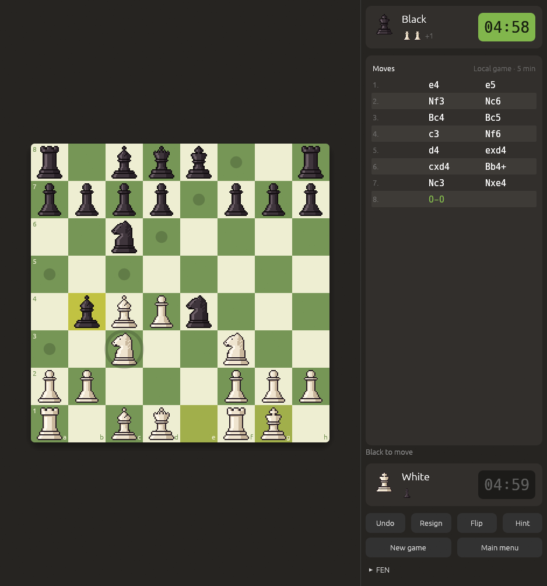
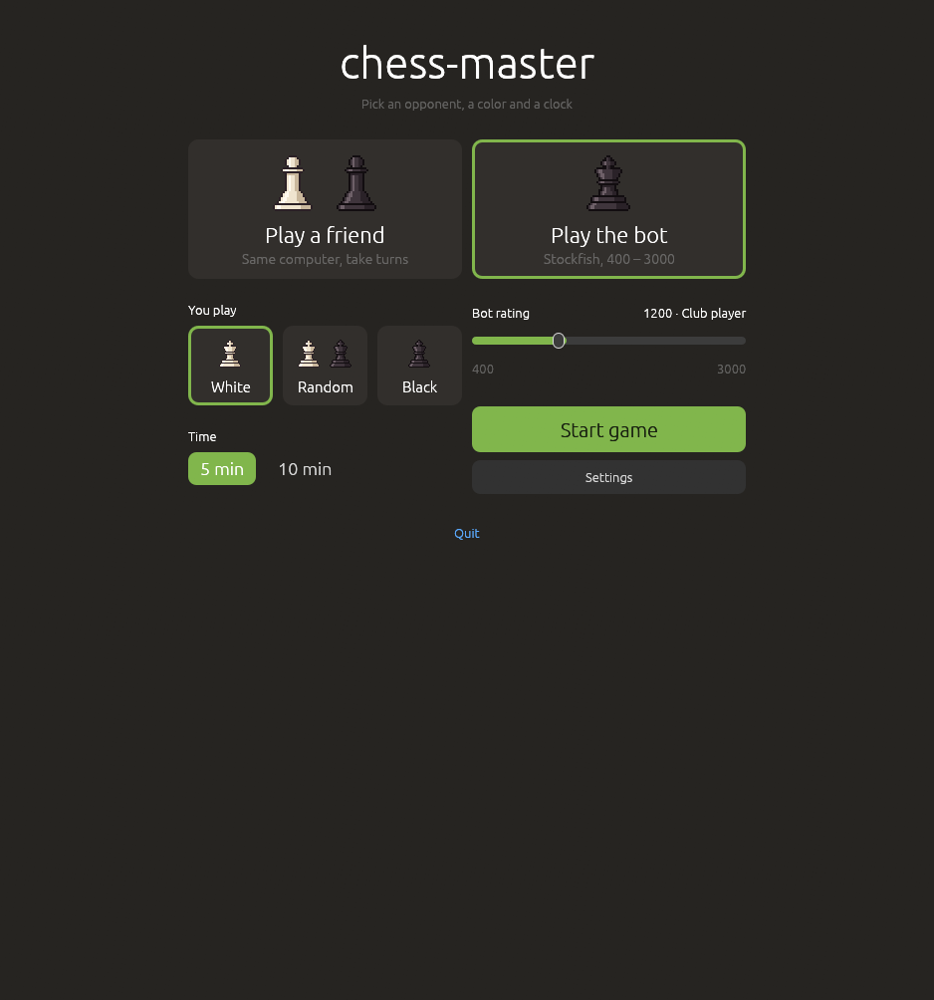
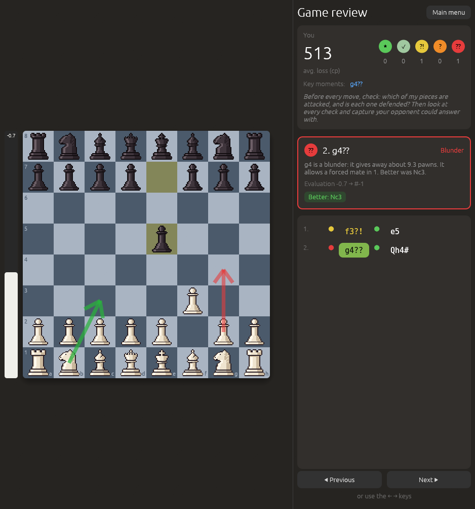
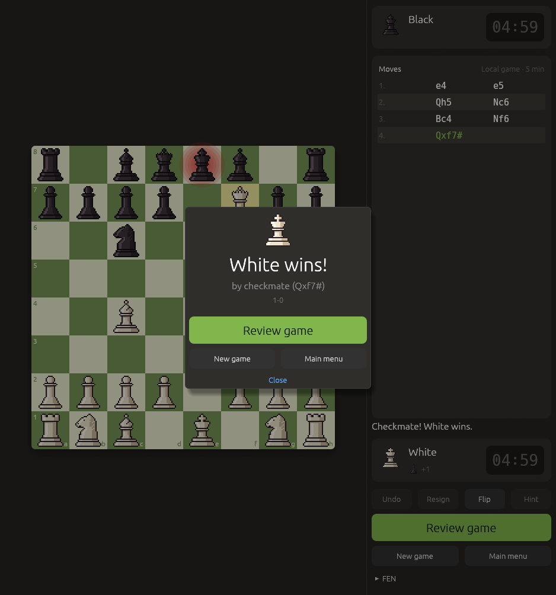
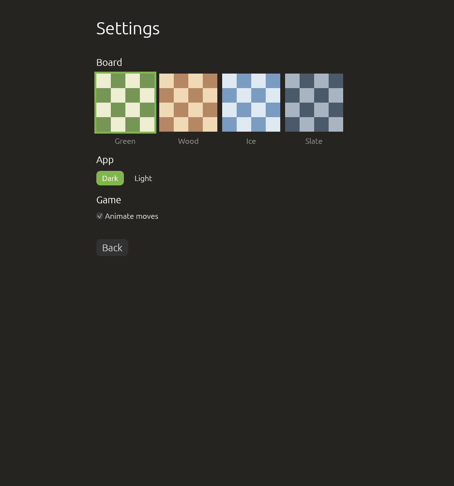
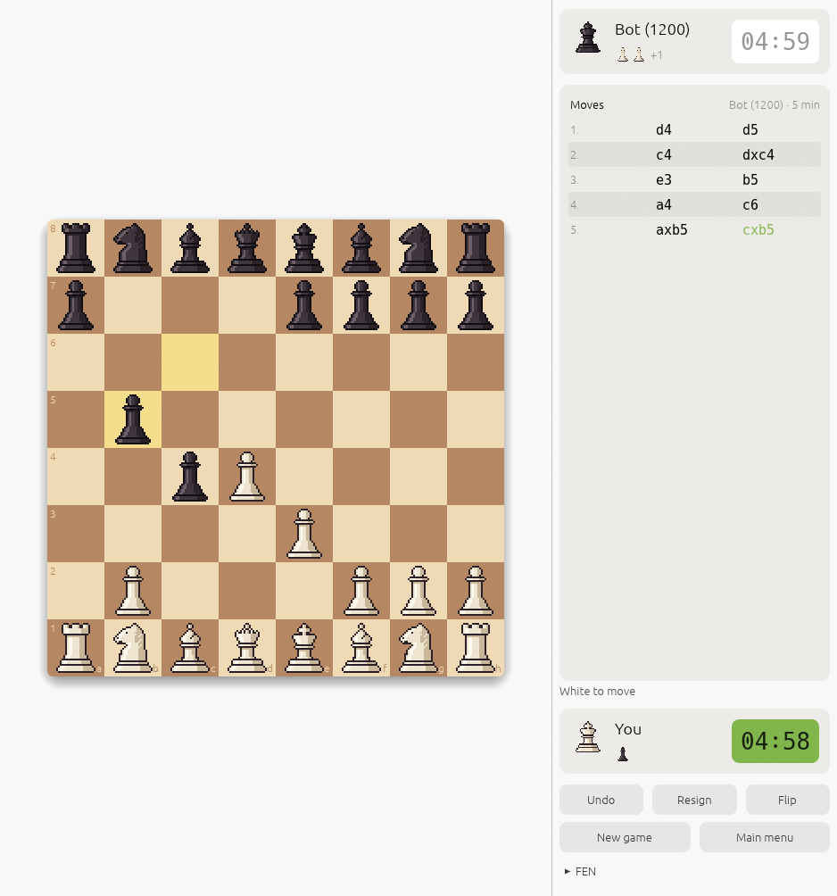

<p align="center">
  
</p>

<h1 align="center">chess-master</h1>

<p align="center">
  A desktop chess app written in <b>Rust</b>: play a friend or the <b>Stockfish</b> bot,<br>
  then let the engine review your game and explain your mistakes.
</p>

<p align="center">
  
</p>

chess-master is a learning project: it was built step by step to learn Rust, from an empty window to an installable app. **All the chess rules are written from scratch** (no chess library). Stockfish is used only as an opponent and as a coach.

> **Status:** version 0.2.0, playable on Linux. Windows and Android are next (see the [Roadmap](#roadmap)).

## Screenshots

| Main menu | Game review |
|---|---|
|  |  |
| **Game over** | **Settings** |
|  |  |

<details>
<summary>Light mode</summary>

</details>

## Features

### Play
- **Two modes:** a friend on the same computer, or the **Stockfish bot**.
- **Choose the bot's rating** from **400 to 3000**, and play as White, Black or a random color.
- **Chess clock** for both players: **5** or **10 minutes**. Run out of time and you lose.
- **Click or drag** a piece. Dots show every square it can legally move to; the last move is highlighted.
- **Undo**, **Resign**, **Flip** the board, and a **Hint** (best move from Stockfish) in local games.
- **Player cards** with the clock, captured pieces and the material difference.
- The **move list** in standard notation (`e4`, `Nf3`, `O-O`, `e8=Q+`) and the position as FEN, ready to copy.
- A **game-over pop-up**: who won, how, and the score (`1-0`, `0-1`, `½-½`).

### Chess rules (written by hand)
- Every piece's movement, including **castling**, **en passant** and **promotion** (you pick the piece).
- **Illegal moves are impossible:** no move may leave your own king in check.
- **Check**, **checkmate** and **stalemate**.
- Draws by the **50-move rule**, **threefold repetition** and **insufficient material**.
- Move generation is verified with **perft tests** against known move counts.

### Game review
After a game, Stockfish analyses every move and rates it by how much it lost, in centipawns (100 = one pawn):

| Rating | Symbol | Lost |
|---|---|---|
| Best | ★ | up to 0.1 pawns |
| Good | ✓ | up to 0.5 |
| Inaccuracy | ?! | up to 1 |
| Mistake | ? | up to 3 |
| Blunder | ?? | more than 3 |

For each move you see **what went wrong** ("it gives away about 9.3 pawns, it allows a forced mate in 1"), the **better move** as a green arrow, an **evaluation bar**, your average loss and the key moments, plus one tip for your next game. Step through the moves with the buttons or the ← → keys.

### Look and settings
- Four **board themes**: Green, Wood, Ice and Slate.
- **Dark** or **light** mode, and smooth **move animation** (can be turned off).
- Pixel-art pieces, hand-drawn in [Aseprite](https://www.aseprite.org/).
- Settings are saved to `~/.config/chess-master/settings.txt` and remembered between runs.

### How the bot's rating works
From **1320** up, Stockfish limits its own strength with its built-in `UCI_Elo` option. Stockfish can't play weaker than that, so **below 1320** the bot uses Stockfish's weakest skill level and only looks 1 to 4 moves ahead. Ratings are approximate: real ratings depend on the time control and the players.

## Install (Linux, x86-64)

The download includes **Stockfish**, so there is nothing else to install.

1. Download `chess-master-<version>-linux-x86_64.tar.gz` from the **Releases** page.
2. Unpack it and run the installer (no `sudo` needed):

   ```sh
   tar -xzf chess-master-*-linux-x86_64.tar.gz
   cd chess-master-*-linux-x86_64
   ./install.sh
   ```

3. Start **chess-master** from your app launcher, or type `chess-master` in a terminal.

The app goes into `~/.local/share/chess-master/`. To remove it again, run `~/.local/share/chess-master/uninstall.sh` (your settings are kept).

Don't want to install? Just run `./chess-master` inside the unpacked folder.

## Build from source

You need:
- [Rust](https://www.rust-lang.org/tools/install) (stable, via `rustup`)
- [Stockfish](https://stockfishchess.org/download/) on your `PATH` (when developing, the app looks for Stockfish next to itself first, then on `PATH`)

```sh
# Arch / CachyOS
sudo pacman -S stockfish

git clone https://github.com/<your-github-user>/chess-master.git
cd chess-master
cargo run --release
```

Useful commands:

```sh
cargo test                    # unit tests (rules, FEN, notation, clock, analysis, ...)
cargo test -- --ignored       # also the slow ones: deep perft and tests with real Stockfish
cargo clippy                  # lints (kept warning-free)
cargo fmt                     # formatting
./scripts/package-linux.sh    # release build + Stockfish -> target/dist/chess-master-<version>-linux-x86_64.tar.gz
```

## How it works

- **Logic and UI are separate.** Everything outside `src/ui/` is pure chess logic and never imports the UI. The UI only draws and calls `Game`; it contains no chess rules.
- **Stockfish runs on its own thread** and talks to it over the [UCI protocol](https://backscattering.de/chess/uci/) through pipes. The UI sends requests over `std::sync::mpsc` channels and checks for answers every frame, so the window never freezes. Each request has an id, so answers that arrive too late are ignored.
- **Two dependencies only:** [`eframe`/`egui`](https://www.egui.rs/) 0.37 for the window and [`image`](https://crates.io/crates/image) (PNG only) for the pieces. Settings are written and read by hand as simple `key = value` lines.
- **Images are built in.** The piece PNGs are embedded in the binary with `include_bytes!` and drawn without smoothing, so the pixel art stays sharp at any size.

## Project structure

```
assets/
├── icon.png            # app icon
└── pieces/             # 32x32 pixel-art piece images (drawn in Aseprite)
docs/screenshots/       # the pictures in this README
scripts/
├── package-linux.sh    # builds the Linux download (app + Stockfish)
└── linux/              # install.sh / uninstall.sh, shipped in the download
src/
├── main.rs             # entry point: opens the window
├── piece.rs            # Color, PieceKind, Piece
├── board.rs            # 8x8 board
├── square.rs           # Square (rank + file)
├── clock.rs            # chess clock
├── position.rs         # side to move, castling, en passant, FEN
├── moves.rs            # Move type and move generation
├── rules.rs            # legal moves, check, checkmate, draws (+ perft tests)
├── san.rs              # move notation: e4, Nf3, O-O, e8=Q+
├── game.rs             # game state, history, undo, result
├── engine.rs           # Stockfish (UCI) on a background thread
├── bot.rs              # bot rating -> Stockfish settings
├── analysis.rs         # move ratings, explanations, summary
├── settings.rs         # board theme, dark/light, animation; saved to a file
└── ui/
    ├── app.rs              # app state, screens, player cards, side panel
    ├── board_view.rs       # board, dots, arrows, animation, clicks and drags, eval bar
    ├── menu.rs             # main menu: opponent, color, rating, time
    ├── piece_textures.rs   # loads the piece images
    ├── review.rs           # game review screen
    ├── settings_screen.rs  # the Settings screen
    ├── theme.rs            # board colors, accent color, dark/light style
    └── widgets.rs          # cards, buttons, a centered column
```

## Roadmap

Built in steps: the window first, then the chess rules, then the Stockfish bot, a polished look, and packaging.

- [x] Foundations: pieces, board, a window with hand-drawn pixel-art pieces
- [x] Playing: click to move, side panel, chess clock, main menu
- [x] Chess rules: FEN, piece movement with move dots, legal moves, check, checkmate, draws, promotion, perft tests, undo, move notation
- [x] The bot: Stockfish over UCI on a background thread, hints, a bot at a chosen rating, game review with explanations
- [x] The look: board themes, Settings screen, dark/light mode, player cards, drag and drop, animations, eval bar, game-over pop-up
- [x] Linux package with Stockfish bundled
- [x] Linux installer: app launcher entry, icon, uninstaller
- [ ] Windows: `.exe` and a `setup.exe` installer with Stockfish
- [ ] Android: APK with Stockfish inside, portrait layout
- [ ] Releases with GitHub Actions: Linux, Windows and Android downloads for every version tag
- [ ] "Update available" notice: the desktop app checks GitHub Releases at startup

## Learning Rust with this project

The main goal of chess-master is learning Rust; a chess app is a good vehicle because it needs a bit of everything: enums and pattern matching for pieces and moves, ownership and borrowing in the game state, error handling for FEN parsing, traits, iterators, unit tests, threads and channels for the engine, and a real GUI.

Resources that helped:
- [The Rust Book](https://doc.rust-lang.org/book/) and [Rust by Example](https://doc.rust-lang.org/rust-by-example/)
- [egui demo](https://www.egui.rs/) and [eframe docs](https://docs.rs/eframe/)
- [Chess Programming Wiki](https://www.chessprogramming.org/), including [perft results](https://www.chessprogramming.org/Perft_Results) and [FEN](https://www.chessprogramming.org/Forsyth-Edwards_Notation)
- [UCI protocol](https://backscattering.de/chess/uci/)

## Credits

- **[Stockfish](https://stockfishchess.org/)**: the chess engine behind the bot, hints and game review. The downloads include the official Stockfish 19 build, unchanged, under the GNU GPL v3; its source code is at [github.com/official-stockfish/Stockfish](https://github.com/official-stockfish/Stockfish/tree/sf_19).
- **[egui / eframe](https://github.com/emilk/egui)**: the GUI library.
- **Piece art**: drawn in Aseprite for this project.

## License

chess-master is free software under the **GNU General Public License v3.0**. See [`LICENSE`](LICENSE).
